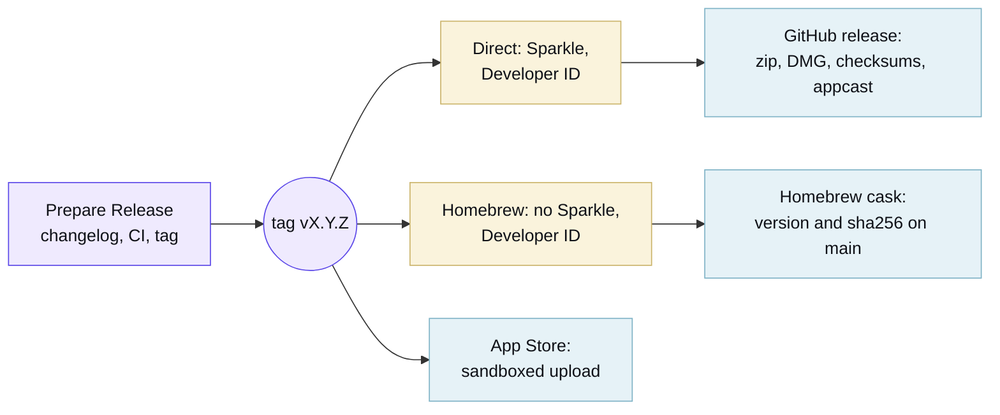

Add a nonempty `changelog.d/<PR>.feature.md`, `.bugfix.md`, or `.doc.md` entry for a user-facing pull request. Apply
`skip news` for changes that need no release note; the label can be added after the pull request opens. Run **Prepare
Release** (`just release patch|minor|major`, or the Actions tab) after merging the changes. It commits the entries to
the [changelog](https://github.com/quotaline/quotaline/blob/main/CHANGELOG.md), runs the full CI matrix on that commit,
and pushes `vX.Y.Z` only after CI passes. The repository-only release App pushes the tag, which starts **Release**. One
run of **Release** publishes all three channels:

Every job requires its credentials: the Direct job needs signing credentials and [Sparkle](https://sparkle-project.org)
keys, and the release stops before any job runs when an App Store certificate or profile is missing, rather than
publishing two channels of three.

Versions 0.1.0 through 0.1.7 were published from the archived macOS repository. Pipeline configuration is not evidence
that a release from this repository or an App Store listing exists. Check the repository's releases before declaring a
build ready.

The release runs no application tests of its own. It reads the CI verdict for the tagged commit and refuses to publish
unless the newest run passed, so a tag carries the full matrix of macOS 15, 26 and 27 rather than the two runtimes a
release once repeated. Everything the release still checks concerns the artifact instead of behaviour: deployment
targets, both architecture slices, Mach-O validity, updater load commands, notarization and the appcast signature.

The three channels are separate Xcode application targets. Only Direct compiles and links `SparkleUpdater`; Homebrew and
App Store do not link the Sparkle product and carry no Sparkle keys in `Info.plist`. Release verification checks both
arm64 and x86_64 slices, Mach-O validity, and updater load commands in the app, zip, and disk image without launching
the application.

### What Apple needs

Enrol in the [Apple Developer Program](https://developer.apple.com/programs/), then create these and store each in the
`release`
[environment](https://docs.github.com/en/actions/how-tos/deploy/configure-and-manage-deployments/manage-environments),
which only `main` and `v*` tags can deploy to. Every job that reads a signing identity names that environment, so a pull
request build cannot reach one:

- `DEVELOPER_ID_CERTIFICATE_BASE64` and `DEVELOPER_ID_CERTIFICATE_PASSWORD`: a **Developer ID Application** certificate
  exported from Keychain Access as a base64-encoded `.p12`.
- `APPLE_DISTRIBUTION_CERTIFICATE_BASE64` and `APPLE_DISTRIBUTION_CERTIFICATE_PASSWORD`: an **Apple Distribution**
  certificate exported the same way.
- `MAC_INSTALLER_DISTRIBUTION_CERTIFICATE_BASE64` and `MAC_INSTALLER_DISTRIBUTION_CERTIFICATE_PASSWORD`: a **Mac
  Installer Distribution** certificate exported the same way.
- `APP_STORE_PROVISIONING_PROFILE_BASE64` and `APP_STORE_WIDGET_PROVISIONING_PROFILE_BASE64`: Mac App Store profiles for
  `tech.bernat.quotaline` and its widget extension.
- `APPLE_TEAM_ID`: the ten-character identifier on the [membership page](https://developer.apple.com/account).
- `APP_STORE_CONNECT_KEY_ID`, `APP_STORE_CONNECT_ISSUER_ID`, and `APP_STORE_CONNECT_KEY_BASE64`: a base64-encoded
  [App Store Connect API key](https://appstoreconnect.apple.com/access/integrations/api) with the App Manager role.
- `SPARKLE_PUBLIC_ED_KEY` and `SPARKLE_PRIVATE_ED_KEY`: keys from Sparkle's `generate_keys` command.

The app record in [App Store Connect](https://appstoreconnect.apple.com) has to exist under the same bundle identifier
before the first upload, along with a `tech.bernat.quotaline` App ID and an app group for the widget.

[Renovate](https://docs.renovatebot.com) opens a grouped pull request each week for the pinned tools, the action digests
and the Swift packages. Read the Docs publishes the site using `.readthedocs.yaml`; the Website workflow validates a
build. Preview and versioned URLs include a base path, so internal links must use Hugo page URLs.
